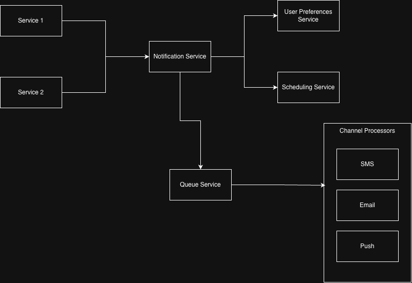

# notification-service

A notification service is a system that send notifications to users through various channels such as email, SMS, push notifications, or in-app messages. It is designed to keep users informed about important events, updates, or actions that require their attention.

In this repo I will be designing a notification service from scratch using Go programming language, and document the process along the way.

## Requirements

Assuming some requirements for the notification service, we can outline the following:

1. Functional requirements:
    - **Multi-channel support**: The service should be able to send notifications through multiple channels (e.g., email, SMS, push notifications).
    - **Scheduled delivery**: The service should allow scheduling notifications to be sent at a specific time or after a certain delay.
    - **User preferences**: The service should allow users to set their notification preferences (e.g., preferred channels, frequency of notifications).
    - **Rate limiting**: The service should ensure that notifications are sent at a controlled rate to avoid overwhelming users or violating service provider limits.
    - **Retry mechanism**: The service should implement a retry mechanism for failed notification deliveries, with configurable retry intervals and maximum attempts.
    - **Logging and monitoring**: The service should log notification delivery attempts, successes, and failures, and provide monitoring capabilities to track the overall health of the system.

2. Non-functional requirements:
    - **Scalability**: This service should be able to handle a large number of notifications and users, and scale horizontally as needed.
    - **Reliability**: The service should be highly available and fault-tolerant, ensuring that notifications are delivered even in the event of failures.
    - **Performance**: The service should have low latency and high throughput, ensuring that notifications are delivered quickly and efficiently.
    - **Security**: The service should implement proper authentication and authorization mechanisms to protect user data and prevent unauthorized access to the notification system.
    - **Maintainability**: The service should be designed with clean code principles, modular architecture, and proper documentation to facilitate future maintenance and enhancements.
    - **Extensibility**: The service should be designed in a way that allows for easy addition of new notification channels or features in the future.

## High level design

I will first design a modular monolith architecture for the notification service, which will allow for easier development and testing of the core functionality. The architecture will consist of the following components:

